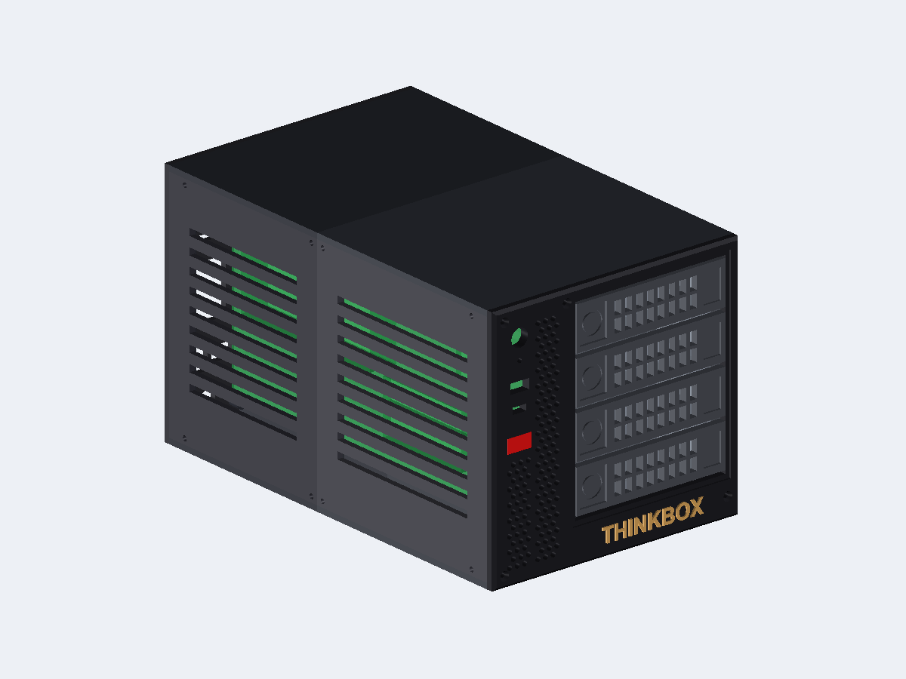
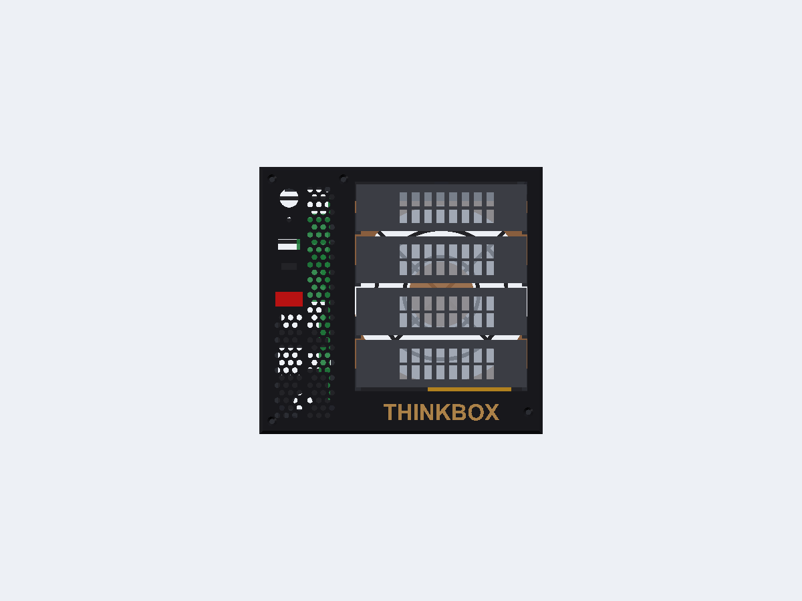
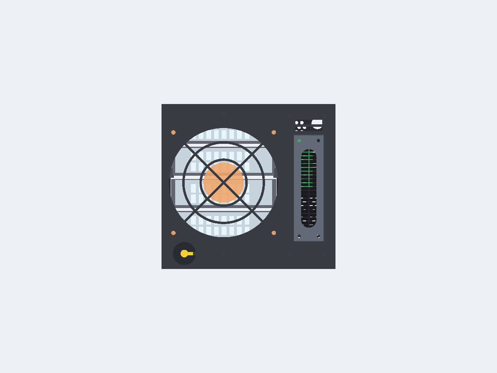
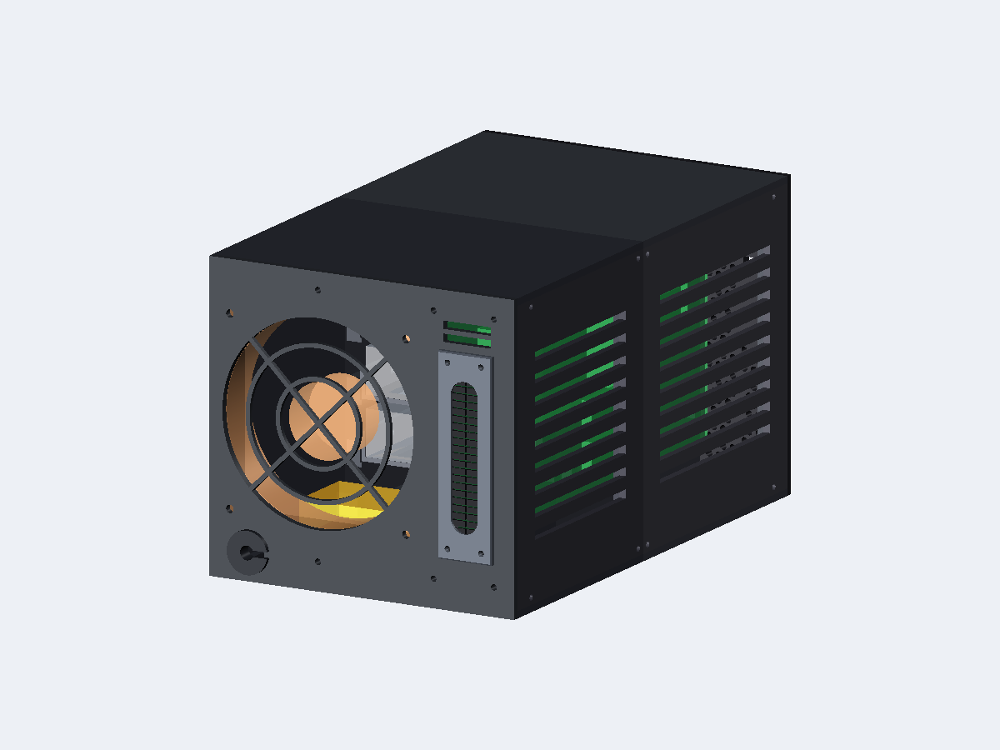
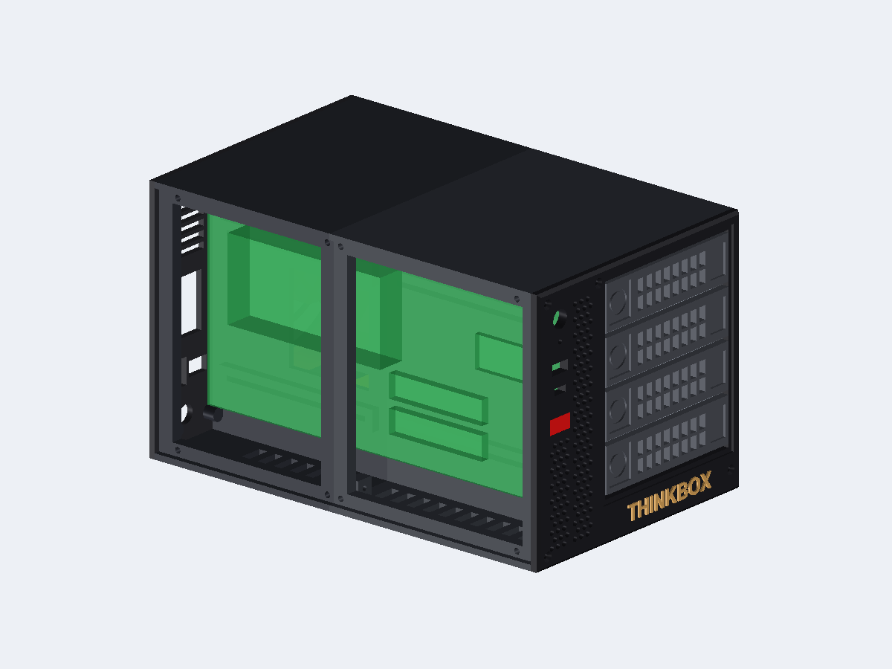
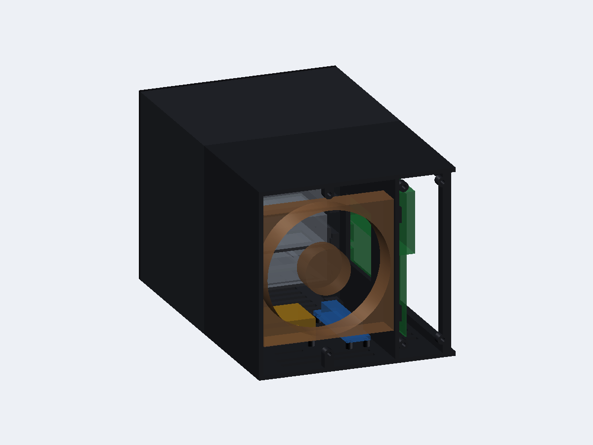

# ThinkBox — ThinkPad L480 4-Bay 3.5" NAS Enclosure

A parametric, 3D-printable 4-bay 3.5" NAS enclosure inspired by the Lenovo ThinkCentre/ThinkBox aesthetic, designed in FreeCAD for a stripped **Lenovo ThinkPad L480** (`EL480` / `NM-B461`) motherboard, an **ASM1166 6-port M.2-to-SATA** adapter, a **Pico PSU**, and a quiet **120 × 25 mm** rear exhaust fan.



## Key Specifications

- **Outer Envelope:** `182 W × 294 D × 172 H mm`
- **Print-Bed Ready Split:** Split at `Y = 158 mm` with tongue-and-groove alignment and 6× M3 bolts — every printable STL fits comfortably on a `256 × 256 mm` print bed (`max dim 182 mm`)
- **Storage:** 4× front-loading removable 3.5" HDD trays (`33.5 mm` pitch, SFF-8301 counterbored `#6-32` side mounting holes, vented cradles & front intake grilles)
- **Cooling:** Rear `120 × 25 mm` quiet fan mount (`105 × 105 mm` spacing, integrated open protective grille) drawing cool air straight across all 4 drives, plus ventilated left service panels and 2× upper L480 rear exhaust louvers
- **Rear Cable Management:** Bolted **brush cable pass-through plate** (`Rear_Brush_Plate` + printable 95A TPU `Rear_Brush_Insert` or clamped strip brush) replacing rigid left-side I/O cutouts for L480 USB-C power, Ethernet, and auxiliary leads, paired with a bottom-right snap-in **split 12V power grommet** (`Rear_Power_Grommet` at `X = 158, Z = 16`) directly behind the Pico PSU
- **Motherboard & Power Layout:**
  - **Left Chamber (`48 mm` wide):** Vertical ThinkPad L480 motherboard mounted via universal slotted standoff rails + full left-side service access (`Left_Cover_Front` / `Left_Cover_Rear`)
  - **Right Rear Plenum:** Dedicated standoffs for the `ASM1166` M.2-to-SATA board and `Pico PSU` below the fan airflow path, with a center-divider cable window for the M.2 PCIe ribbon riser and SATA wiring
- **Verified Geometry:** All 15 printable solids validated (`isValid = True`), all 12 STLs verified watertight, and `0.0000 mm³` interference across all 80 hardware, tray, bezel, rear pass-through, and split-joint pairs

## Gallery

| Front Bezel & Trays | Rear Fan, Brush Plate & Grommet | Rear-Left 3D Detail |
| :---: | :---: | :---: |
|  |  |  |

| L480 Motherboard Chamber | Rear Plenum (120 mm Fan, ASM1166, Pico PSU) |
| :---: | :---: |
|  |  |

## Repository Contents

| Path | Description |
| :--- | :--- |
| [`ThinkPad_L480_NAS.FCStd`](ThinkPad_L480_NAS.FCStd) | Full FreeCAD assembly (`01_Chassis`, `02_Panels_and_Bezel`, `03_HDD_Trays`, `04_Reference_Hardware`, `Parameters` spreadsheet) |
| [`build_thinkpad_nas.py`](build_thinkpad_nas.py) | Parametric FreeCAD Python generator script (rebuilds `.FCStd` and exports all STLs) |
| [`ASSEMBLY_AND_BOM.md`](ASSEMBLY_AND_BOM.md) | Print orientations, hardware & fastener BOM, wiring diagram notes, and assembly steps |
| [`stl/`](stl/) | 12 watertight, print-ready STL meshes (`Chassis_Front.stl`, `Chassis_Rear.stl`, `Front_Bezel.stl`, `Front_Bezel_Text.stl`, `ThinkPad_Red_Accent.stl`, `Rear_Panel.stl`, `Rear_Brush_Plate.stl`, `Rear_Brush_Insert.stl`, `Rear_Power_Grommet.stl`, `Left_Cover_Front.stl`, `Left_Cover_Rear.stl`, `HDD_Tray.stl` ×4) |
| [`images/`](images/) | Rendered orthographic, isometric, and internal inspection views |

## Printing & Assembly

See [`ASSEMBLY_AND_BOM.md`](ASSEMBLY_AND_BOM.md) for:
- Recommended bed orientations, filament choices (PETG/ASA + 95A TPU options for `Rear_Brush_Insert` and `Rear_Power_Grommet`), and per-part quantities (`15` printed parts total)
- Complete electronics list, 24× M3 heat-set inserts, M3 screws & brush-plate bolts/nuts, `#6-32` HDD screws, and rubber feet
- Step-by-step assembly and airflow/cable routing instructions

## Parametric Customization

All envelope, rail, fan, and fastener dimensions live in the `PARAMS` dictionary at the top of [`build_thinkpad_nas.py`](build_thinkpad_nas.py) (and are mirrored to the `Parameters` spreadsheet in `ThinkPad_L480_NAS.FCStd`). Edit any value and regenerate both the FreeCAD document and `stl/` meshes headlessly:

```powershell
& "C:\Program Files\FreeCAD 1.1\bin\freecadcmd.exe" build_thinkpad_nas.py
```
